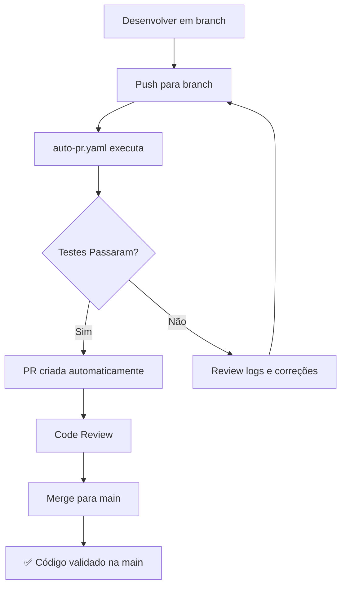
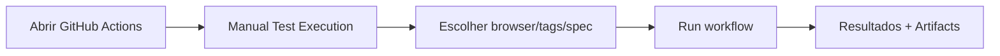

# GitHub Actions Workflows - Cypress Test Automation

Este diretório contém **2 workflows automatizados** para execução dos testes Cypress do projeto HCXpert QA Challenge 2026.

## 📁 Workflows Disponíveis

### 1. `auto-pr.yaml` - Auto PR com Testes ✅

**Trigger:** Push em qualquer branch (exceto main)

**Função:**

- Executa todos os testes Cypress automaticamente
- Gera evidências (screenshots, vídeos, relatórios)
- Cria Pull Request automaticamente para `main` se os testes passarem
- Adiciona comentário em PRs existentes quando novos testes são executados

**Uso:**

```bash
git checkout -b feature/nova-funcionalidade
# Faça suas alterações
git add .
git commit -m "feat: implementa nova funcionalidade"
git push origin feature/nova-funcionalidade
```

A PR será criada automaticamente após os testes passarem! 🚀

---

### 2. `manual-tests.yaml` - Execução Manual 🎯

**Trigger:** Workflow Dispatch (manual)

**Função:**

- Permite executar testes sob demanda
- Escolher browser (Chrome, Firefox, Edge)
- Filtrar por tags (@smoke, @api, @e2e, etc.)
- Especificar arquivo .feature específico

**Uso:**

1. Vá para: `Actions` → `Manual Test Execution`
2. Clique em `Run workflow`
3. Selecione:
   - **Browser:** chrome / firefox / edge
   - **Tags:** @smoke, @api, @negativo, etc.
   - **Spec:** arquivo específico ou deixe em branco para todos

**Exemplos de Tags:**

```
@smoke              # Apenas testes smoke
@api                # Apenas testes de API
@smoke,@positivo    # Testes smoke E positivos
@e2e                # Teste end-to-end completo
```

---

## 📊 Artifacts Gerados

Cada workflow gera os seguintes artifacts:

| Artifact       | Descrição                                    | Retenção   |
| -------------- | -------------------------------------------- | ---------- |
| 📸 Screenshots | Capturas de tela (apenas em falhas)          | 30-90 dias |
| 📹 Videos      | Gravações de tela de todos os testes         | 7-30 dias  |
| 📄 Reports     | Relatórios HTML/JSON (Cucumber, Mochawesome) | 30-90 dias |

### Como Baixar Artifacts

1. Vá para `Actions` → Selecione o workflow executado
2. Role até o final da página
3. Na seção **Artifacts**, clique para baixar

---

## 🔐 Secrets Necessários

Os workflows usam as seguintes secrets (já configuradas):

| Secret         | Uso                                                   |
| -------------- | ----------------------------------------------------- |
| `GITHUB_TOKEN` | Criação automática de PRs (fornecido automaticamente) |

⚠️ Não há necessidade de configurar secrets adicionais para este projeto, pois os testes são executados contra site público (automationexercise.com).

---

## 🎯 Fluxo Completo de Trabalho



**Fluxo Manual:**



---

## 🛠️ Manutenção dos Workflows

### Atualizar versão do Node.js

```yaml
- name: Setup Node.js
  uses: actions/setup-node@v4
  with:
    node-version: 20 # Altere aqui
```

### Adicionar novo browser

```yaml
# Em manual-tests.yaml
options:
  - chrome
  - firefox
  - edge
  - electron # Adicione aqui
```

### Alterar retenção de artifacts

```yaml
retention-days: 30 # Altere aqui (1-90 dias)
```

---

## 📚 Documentação Adicional

- [GitHub Actions Docs](https://docs.github.com/en/actions)
- [Cypress GitHub Action](https://github.com/cypress-io/github-action)
- [Workflow Syntax](https://docs.github.com/en/actions/using-workflows/workflow-syntax-for-github-actions)

---

**Última atualização:** 2026-07-14  
**Projeto:** HCXpert QA/SDET Technical Challenge 2026
